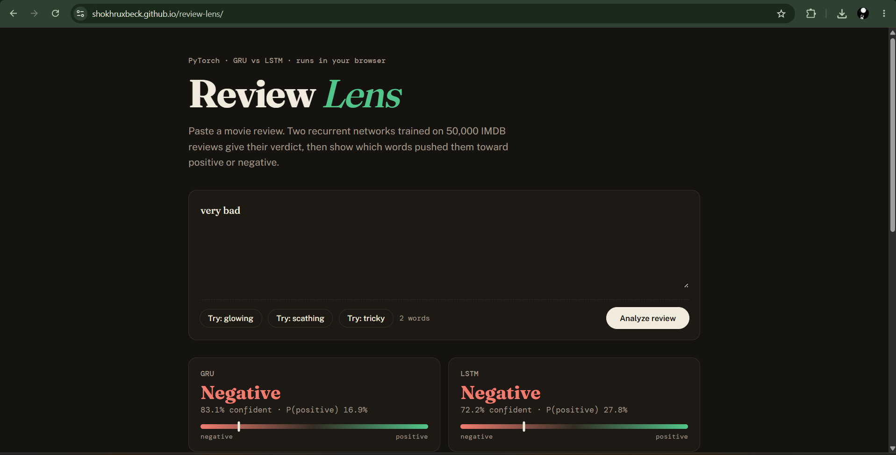

# Review Lens: GRU vs LSTM movie review sentiment

Two recurrent networks trained in PyTorch read a movie review, give a verdict, and highlight the words that decided it. Everything runs **in your browser**: no server, no backend, nothing you type leaves your device.

### [▶ Try the live demo](https://shokhruxbeck.github.io/review-lens/)

## Results

Measured on **10,000 reviews held out from training** (validation set):

| Model | Accuracy | F1 | Parameters |
|-------|----------|----|-----------|
| GRU   | 88.3%    | 0.881 | 926,321 |
| LSTM  | 86.1%    | 0.857 | 931,569 |

Data: IMDB 50k movie reviews (25k positive, 25k negative).

## Model

Review → lowercase and clean → words → ids (vocabulary of 56,907 words) → embedding (16) → GRU or LSTM (64 units) → linear → sigmoid.
Only the first 300 words of a review are used. Shorter reviews are left-padded.

## How the page explains a verdict

Each word is removed in turn and the review is scored again. If the positive probability drops, the word was pushing positive; if it rises, negative. This shows what the model reacts to, not what is objectively true.

## How it runs in the browser

The trained PyTorch weights (exported from the notebook, embedding stored as float16) are embedded in the page, and the GRU and LSTM forward passes are written in plain JavaScript. I checked the JavaScript output against PyTorch on the same inputs: probabilities match to about 4e-5.

## An honest note on evaluation

My first notebook evaluated on a "test" set that was split separately from the training split, so some test reviews had been seen in training. That made the reported test accuracy too optimistic. The numbers above come from the validation set, which the models never trained on.

## Limitations

- English movie reviews only.
- Sarcasm, mixed opinions and very short texts confuse it.
- Words not seen in training are ignored.

**Tech:** PyTorch, scikit-learn, pandas, JavaScript, HTML/CSS
